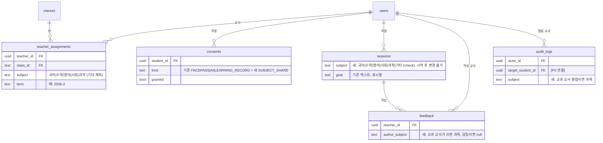

상태: 승인

# 데이터 — 교과 교사 배정 추가분 (2026-11-14)

기존 테이블 전체 정의는 백엔드 저장소에 있다. 여기에는 이번 기능으로 **새로 생기거나 바뀌는 것**만 적는다. 실제 컬럼 이름은 백엔드 확인 후 맞춘다(미정 표시).

## 데이터 사전 (새·바뀐 것)
| 테이블.컬럼 | 뜻 | 비고 |
|---|---|---|
| `teacher_assignments` | 교사가 어느 반 어느 과목을 맡는지 | PK (teacher_id, class_id, subject, term). 담임은 기존 `users.class_id` 그대로(교과만 맡은 교사는 NULL) |
| `teacher_assignments.term` | 학기 | 현재 학기만 권한 인정. 현재 학기 = 서울 날짜 기준 3~8월 `YYYY-1`, 9~2월 `YYYY-2`(1~2월은 전년도). 서버에도 같은 규칙 함수 요청 |
| `sessions.subject` | 학습 시작 때 고른 과목 | 새 컬럼, `check (subject in ('국어','수학','영어','사회','과학','기타'))`. 권한 판단은 이 컬럼으로(`goal` 텍스트 파싱 금지). 기존 행은 goal 첫 칸으로 백필 |
| `consents.kind = SUBJECT_SHARE` | 교과 교사 공개 동의 | 기록 없으면 미동의. 철회 즉시 반영. `LEARNING_RECORD` 동의가 없으면 무효 |
| `feedback.author_subject` | 피드백 쓴 교사의 과목 | 표시용 스냅숏. 배정이 바뀌어도 그때 과목 유지 |
| `audit_logs.subject` | 교과 교사 열람 과목 | 학생 동의 화면 열람 기록에 표시 |

## 개인정보
- 새 개인정보 항목은 없다. 기존 학생 기록이 **보이는 사람**이 늘어난다(05-data-flow.md).
