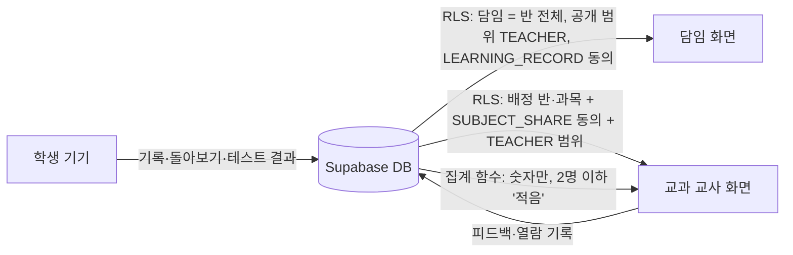

상태: 승인

# 데이터 흐름 — 교과 교사 열람 추가분 (2026-11-14)

새로 수집하는 개인정보는 없다. 바뀌는 것은 **누가 볼 수 있는지**다.

| 데이터 | 서버로 보냄 | 저장 | 보는 사람(새 규칙) |
|---|---|---|---|
| 학습 과목 `goal.subject` | 예(기존) | `sessions` | 학생, 담임, 그 과목 교과 교사(동의 시) |
| 기록 내용(메모·질문·종이) | 예(기존) | `entries` | 공개 범위 `TEACHER`만: 담임, 그 과목 교과 교사(동의 시). `PRIVATE`은 학생만 |
| 주제·테스트 결과 | 예(기존) | `session_topics`, `quiz_attempts` | 담임과 같은 동의 조건. 주제는 `TEACHER` 기록에서만 추출(기존). 교과 교사는 그 과목 학습의 것만 |
| 돌아보기(자유 메모 포함) | 예(기존) | `reflections` | 담임, 그 과목 교과 교사(`LEARNING_RECORD`+`SUBJECT_SHARE` 동의 시) |
| AI 대화 | 예(기존) | `ai_messages` | 담임만. 교과 교사는 0건 |
| 학습 횟수·시간 | 예(기존) | `sessions` | 담임: 미동의도 횟수·시간만(기존). 교과 교사: 동의 학생의 그 과목 학습만 |
| 반·과목 주간 집계 | 서버 계산 결과만 | 저장 안 함(조회 시 계산) | 그 반·과목 교과 교사. 동의 학생만 셈, 2명 이하 숨김 |
| 피드백 + 작성 과목 | 예 | `feedback` | 학생, 담임, 작성 교사 |
| 열람 기록 + 과목 | 예 | `audit_logs` | 학생 본인(동의 화면), 관리자 |
| 교사 메모 | 아니오 | 교사 브라우저 localStorage(기존) | 그 브라우저 |

- 프론트가 거르는 것은 표시용이다. 기준은 서버 RLS다. 프론트 mock은 같은 규칙 함수로 동작을 흉내 낸다.
- AI로 새로 보내는 데이터는 없다.
- 교과 교사는 **현재 학기에 시작한 학습**만 본다. 지난 학기 학습은 배정이 남아 있어도 숨는다.
| 학생 질문(`QUESTION`, 교사 공개 범위, LEARNING_RECORD·SUBJECT_SHARE·AI 세 동의, 이번 주) | 예(새로): 서버가 AI에 보냄. 마스킹한 글 + 임시 번호만, 이름·번호·학생 ID 없음 | 묶음 요약 `question_themes`(제목·학생 수·주제만, 질문 원문 없음) | 그 반·과목 교과 교사. 학생 3명 미만 묶음은 숨김, 동의 철회 시 숨김 |
